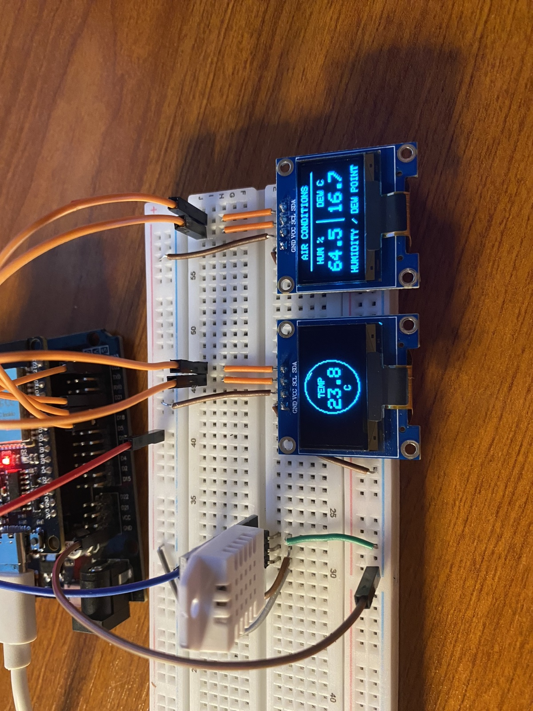

# Home Sensor

An ESP32-based home sensor that measures temperature and humidity using a DHT22 and displays the readings on two OLED screens.

The firmware reads the sensor every three seconds and calculates the dew point. The second screen alternates between humidity and dew point, and the minimum and maximum temperatures recorded since startup.

## Two-screen prototype

| Humidity and dew point | Temperature history |
| :---: | :---: |
|  |  |

This is an early prototype and a foundation for future additions, including more sensors and data logging.
