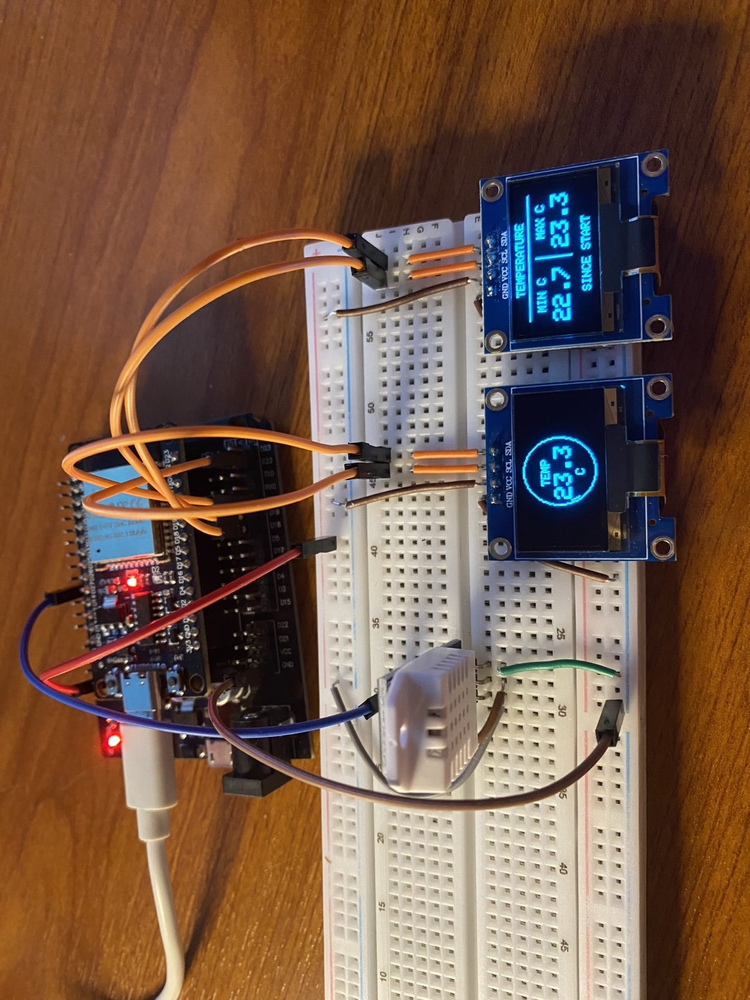

# Home Sensor

An ESP32-based home sensor that monitors temperature and humidity with a DHT22 and displays the readings on two OLED screens.

| Humidity and dew point | Temperature history |
| :---: | :---: |
|  |  |

## How it works

The firmware reads temperature and relative humidity every three seconds. It uses these values to estimate the **dew point** with the Magnus formula. The dew point is the temperature at which water vapour in the air can begin to condense on a sufficiently cold surface.

- **First display:** current temperature inside an animated circle.
- **Second display:** alternates every 15 seconds between humidity and dew point, and minimum and maximum temperature.

The minimum and maximum are recorded since the ESP32 was last started and reset when it restarts. Invalid sensor readings are reported and are not used to update these values. Readings are also sent to the serial monitor.

This is an early prototype and a foundation for future additions, including more sensors and data logging.
