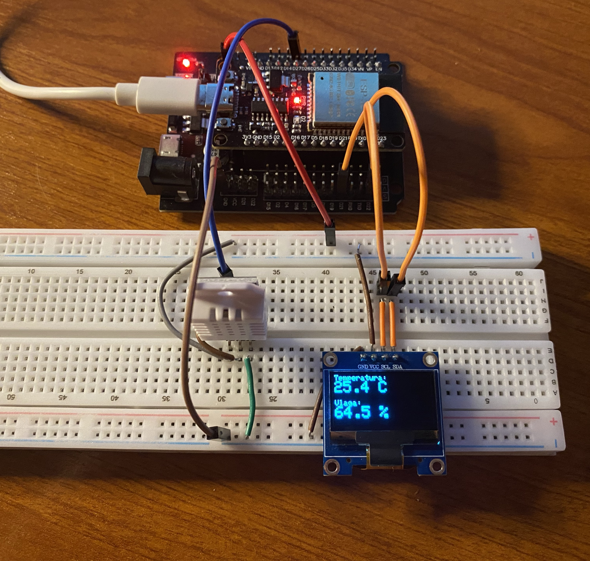

# Home Sensor

An ESP32-based home sensor that measures temperature and humidity using a DHT22 and displays the readings on an OLED screen.

The firmware reads the sensor every three seconds and shows the results on the display and in the serial monitor. If a reading fails, it displays an error message.

This is an early prototype and a foundation for future additions, including more sensors and data logging.
